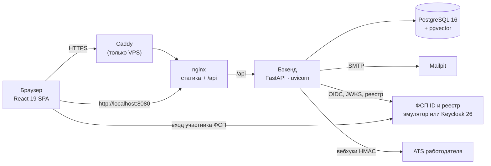

# Архитектура «Скаута» — как построено

Этот документ описывает решение в том виде, в каком оно сдаётся. Обоснование механик — в
[APPROACH.md](APPROACH.md), точный список библиотек — [LIBRARIES.md](LIBRARIES.md).

## 1. Компоненты



| Сервис | Образ | Память | Что делает |
|---|---|---|---|
| `frontend` | nginx 1.31 | 32 МБ | SPA, проксирование `/api`, CSP и заголовки безопасности |
| `backend` | python:3.13-slim | 640 МБ | API (`WEB_CONCURRENCY` процессов uvicorn, по умолчанию 2), адаптивный тест, подбор, фоновая отправка вебхуков |
| `db` | pgvector/pgvector:0.8.7-pg16 | 512 МБ | Все данные; миграции Alembic при старте |
| `fsp-registry-mock` | python:3.13-slim | 96 МБ | ФСП ID (OIDC, PKCE, RS256) и реестр достижений |
| `mailpit` | axllent/mailpit 1.31 | 64 МБ | Почтовый ящик стенда |
| `keycloak` (оверлей) | keycloak 26.4 | ~700 МБ | ФСП ID на полноценном Keycloak — тот же протокол |
| `caddy` (оверлей VPS) | caddy 2.10 | 64 МБ | HTTPS, `fsp.DOMAIN`, `mail.DOMAIN` за паролем |

Стенд работает офлайн после сборки, без GPU и без внешних API, в том числе без LLM.

## 2. Слои бэкенда

```
api (FastAPI-роутеры, зависимости, роли)  →  services (сценарии и правила)  →  crud (единственный доступ к БД)  →  models (SQLAlchemy)
                                     schemas (Pydantic: вход и выход API)
```

Роутер не знает о SQL, сервис не собирает запросы сам — вся работа с базой идёт через модули
`app/crud`. Сервисы получают сессию и источник времени, поэтому тесты подставляют свои часы.

| Модуль `app/services` | Ответственность |
|---|---|
| `auth` | Регистрация, подтверждение email, вход, ротация refresh-токена, вход через ФСП ID |
| `candidate` | Анкета, приватность, разбор PDF-резюме на правилах, PDF-профиль |
| `assessment` | Опрос → blueprint, 79 параметрических семейств заданий, IRT 3PL, CAT, EAP по ходу и WLE для итога, решение о грейде, правила пересдачи, калибровка, кабинет методиста |
| `matching` | Разбор текста потребности, пул по категории с автодополнением соседними грейдами, индекс подтверждённого профиля, балл соответствия `match-1.1`, объяснения, рынок, версии подборок, банк |
| `invitations` | Автомат статусов, обязательная вилка, квоты, раскрытие контактов после принятия |
| `vacancies` | Вакансии, лента кандидата по баллу, отклики |
| `microtasks` | Задачи «решить» и «предложить подход», адресная раздача, оценка |
| `fsp` | Привязка ФСП ID, синхронизация достижений, балл ФСП |
| `trust` | Проверка ИНН, уровни доверия, жалобы, модерация, репутация |
| `integrations` | Вебхуки ATS через outbox, подпись, защита от SSRF, выгрузка CSV/JSON |
| `account` | Права по 152-ФЗ: выгрузка всех данных и удаление аккаунта |

API: 126 методов в 21 группе, OpenAPI — [openapi.json](openapi.json), Swagger UI работает без
интернета (`/api/docs`). Типы фронтенда генерируются из этой спецификации (`make openapi`).

## 3. Данные

48 таблиц, 9 миграций Alembic. Ключи — UUID, у справочников — `smallint`.

| Домен | Таблицы |
|---|---|
| Идентификация и согласия | `users`, `refresh_sessions`, `email_verification_tokens`, `consents` (журнал: отзыв проставляет дату, строка остаётся) |
| Справочники | `industries`, `specializations`, `grades`, `categories` (специализация × грейд, порог θ), `skills` с алиасами, `specialization_skills`, `skill_relations` |
| Кандидат | `candidate_profiles`, `candidate_skills` (заявлен / подтверждён тестом), `work_experiences`, `educations`, `privacy_settings` |
| Оценка | `competencies`, `specialization_competencies` (blueprint), `item_families` (параметры IRT, статус, счётчики), `survey_responses`, `assessment_sessions`, `assessment_items` (экземпляр и ключ ответа на сервере), `grade_history` |
| Работодатель и подбор | `companies`, `recruiters`, `hiring_needs`, `need_skills`, `shortlists`, `shortlist_entries`, `shortlist_marks` |
| Контакт | `invitations`, `invitation_events`, `contact_disclosures`, `vacancies`, `vacancy_skills`, `applications`, `application_events` |
| Актуальность и ФСП | `microtasks`, `microtask_assignments`, `fsp_links`, `fsp_achievements`, `fsp_sync_log`, `oidc_flow_states` |
| Доверие и интеграции | `complaints`, `webhook_endpoints`, `webhook_deliveries` (outbox), `notifications`, `audit_log` |

Каскады устроены так, что удаление аккаунта уничтожает все данные человека в БД; аудит хранит
автора как `SET NULL`, поэтому решения модерации остаются без персональных данных.

## 4. Ключевые сценарии

**Тест.** Опрос задаёт blueprint: языковые компетенции включаются по стеку. Каждое задание —
экземпляр семейства, seed которого — HMAC от секрета сервера, соли сессии, позиции и кода
семейства; ключ ответа не покидает сервер, дедлайн задания хранит сервер. Следующее задание —
максимум информации около порога заявленного грейда с учётом дефицита blueprint, случайного
выбора из лучших и штрафа за частые показы. Остановка — классификационное правило; итоговая
оценка — WLE, решение — с запасом, подтверждён или нет, с правилами пересдачи.
Подробно — [ASSESSMENT.md](ASSESSMENT.md).

**Подбор.** Текст потребности разбирается правилами; жёсткие фильтры — категория, согласие на
публикацию, статус поиска; если точного грейда меньше десяти кандидатов, добавляются соседние.
Балл: 0,30 · навыки + 0,20 · индекс профиля + 0,15 · текст + 0,35 · условия, с понижением за
неподтверждённый и соседний грейд. Каждая подборка сохраняет версию алгоритма. Подробно —
[MATCHING.md](MATCHING.md), метрики — [VALIDATION.md](VALIDATION.md).

**Контакт.** Карточка обезличена; контакты отдаются отдельным объектом только при записи о
раскрытии, которая появляется при принятии приглашения или отклике и пишется в аудит. Событие
уходит в ATS работодателя через outbox в той же транзакции.

**ФСП ID.** Authorization Code + PKCE, проверка подписи по JWKS, отдельное согласие на доступ к
достижениям, отвязка удаляет полученные данные. Эмулятор и Keycloak взаимозаменяемы
переменными окружения — [FSP_INTEGRATION.md](FSP_INTEGRATION.md).

## 5. Безопасность и 152-ФЗ

- Пароли — argon2id; access-JWT на 15 минут с claims как у Keycloak; refresh-токен — в
  httpOnly-cookie `SameSite=strict`, ротация с обнаружением повторного использования.
- Ограничение частоты на регистрацию, вход, жалобы, выгрузки; CSP без inline-скриптов.
- В production бэкенд не стартует с секретами из репозитория (`JWT_SECRET`, `ASSESSMENT_SECRET`,
  `FSP_CLIENT_SECRET`).
- Согласия даются раздельно: обработка ПДн, публикация в банке, доступ к данным ФСП.
- «Мои данные»: выгрузка всего, что хранится о человеке, одним JSON (секреты исключены) и
  удаление аккаунта с каскадом, удалением копий событий ATS и записью факта в аудит.
- Вебхуки ATS подписаны HMAC-SHA256, адреса получателей проверяются против SSRF.

## 6. Фоновые задачи

В каждом процессе API asyncio-задача отправляет вебхуки из outbox (`SELECT … FOR UPDATE SKIP
LOCKED`, повторы с нарастающей паузой): несколько процессов не отправят одно событие дважды.
Истечение приглашений и микрозадач выполняется лениво при обращении — отдельный планировщик не
нужен. Хеширование паролей argon2id идёт в отдельном потоке, не больше двух хешей одновременно на
процесс: цикл событий не останавливается, а всплеск входов не съедает память и ядра.

## 7. Проверки

| Что | Как |
|---|---|
| Бэкенд | pytest на реальном PostgreSQL: каждый тест в транзакции с откатом; ruff, mypy strict |
| Фронтенд | vitest, eslint, tsc |
| Эмулятор ФСП | pytest, ruff, mypy |
| Правила кода | `tools/check_code_style.py`: docstring и комментарии на русском, комментарии только внутри функций |
| Валидация методик | `make simulate`, `make validate-assessment`, `make eval-matching` → [VALIDATION.md](VALIDATION.md) |
| Нагрузка | `make load-stand && make load-test` → [LOAD_TEST.md](LOAD_TEST.md) |
| Развёртывание | `deploy/check.sh` → [DEPLOYMENT.md](DEPLOYMENT.md) |
