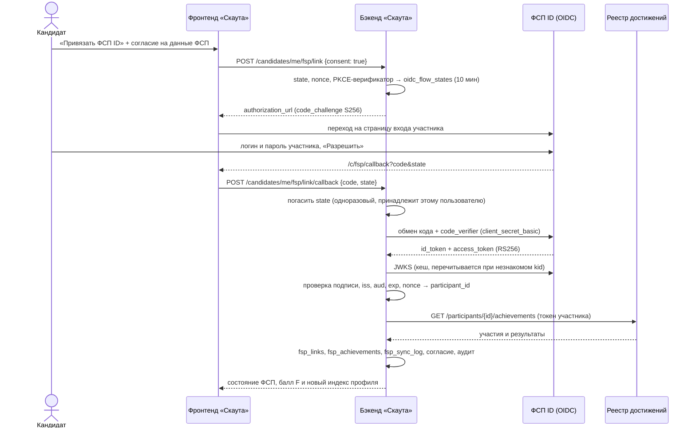

# Интеграция с ФСП: ФСП ID и реестр достижений

ТЗ требует связать профиль с ID участника ФСП и корректно обработать отсутствие истории ФСП.
Доступов к боевому ФСП ID у команд нет, а менторы предложили имитировать вход и привязку.
Поэтому в стенде работает отдельный сервис `fsp-registry-mock`. Он реализует тот же протокол,
что Keycloak, и бэкенд «Скаута» разговаривает с ним как с настоящим провайдером. Чтобы подключить
боевой ФСП ID, нужно поменять четыре переменные окружения, код при этом не меняется.

## 1. Схема



Браузер ходит к ФСП ID по публичному адресу (`http://localhost:8090`). Бэкенд внутри Docker
обращается к тому же провайдеру по имени сервиса (`http://fsp-registry-mock:8090`). Клиент сам
переводит адреса из discovery во внутренние, поэтому claim `iss` в токенах остаётся публичным,
как у настоящего провайдера за балансировщиком.

Код авторизации возвращается во фронтенд, а не на бэкенд. Refresh-cookie «Скаута» ограничена
путём `/api/v1/auth` и `SameSite=Strict`, поэтому завершать привязку должен сам кабинет: он
отправляет `code` и `state` с access-токеном пользователя.

## 2. Какие данные получаем

| Получаем | Не получаем |
|---|---|
| ID участника, регион, спортивный разряд | ФИО (нет ни в id_token, ни в API реестра) |
| По каждому участию: мероприятие, уровень, дисциплина, дата, очно или онлайн | Дата рождения, документы |
| Формат (личный или командный), команда и роль в ней | Контакты |
| Место, число участников, статус результата, рейтинговые баллы, ссылка на протокол | |

Получение данных ФСП — отдельное согласие по 152-ФЗ (`fsp_data_access` в журнале согласий).
Без отметки согласия привязка не начинается. Отвязка удаляет участия и привязку и отзывает
согласие; запись в журнале остаётся с датой отзыва, событие пишется в аудит.

Ответ реестра проверяется схемой до записи в базу. Ссылка на протокол пропускается, только если
это `http(s)`. Иначе запись реестра вида `javascript:…` стала бы XSS в карточке работодателя.
Фронтенд дополнительно проверяет схему и открывает ссылку с `rel="noopener noreferrer"`.

## 3. Три состояния (и четвёртое — «скрыто»)

| Состояние | Когда | F | Что видит работодатель |
|---|---|---|---|
| `not_linked` | ФСП ID не привязан | 0 | «Профиль ФСП не привязан — оценка основана на тесте и профиле» |
| `linked_empty` | Привязан, в реестре нет участий | 0 | «ФСП ID привязан, участий в соревнованиях пока нет» и разряд, если есть |
| `linked` | Привязан, есть участия | 0…1 | Сводка, лучший результат, разряд, лента участий с протоколами |
| `hidden` | Кандидат выключил «Показывать достижения ФСП» | 0 | «Кандидат не показывает достижения ФСП» — без участий и без балла |

`F = 0` во всех нейтральных состояниях означает отсутствие бонуса, а не штраф: индекс строится
по тесту и профилю, и это сказано в карточке и в блоке «Почему в подборке». Скрытые достижения
не участвуют ни в балле, ни в фильтре «есть ФСП». Иначе по порядку выдачи можно было бы
догадаться о том, что человек решил не показывать. Так же устроены скрытые зарплата и город.

## 4. Балл ФСП

```
F = min(1; 0,6·R + 0,4·N)

R = Σ w·c / (Σ w + 1)       c = 1 за победу или призовое место, 0,5 за финал, 0 за участие
N = 1 − exp(−M / 3)         M — взвешенное число участий
w = 0,5^(возраст в месяцах / 24)
```

- **Без дискриминации по уровню и дисциплине.** Так просили менторы ФСП: международный кубок
  и городской турнир, робототехника и продуктовое программирование весят одинаково. Уровень и
  дисциплина показываются работодателю только как контекст. На балл влияют число участий и
  результативность.
- **Единица в знаменателе R** — это априорный «старт без результата». Одна победа из одного
  старта даёт R = 0,5, пять из пяти — 0,83: стабильный результат весит больше разовой удачи.
- **Онлайн-явки без результата** не входят в R, а в M добавляют убывающий вклад
  `0,3 · 0,7^i`. Суммарно это не больше одного очного участия, поэтому профиль нельзя набить
  регистрациями.
- **Командные результаты** засчитываются участнику целиком: ФСП ID не фиксирует вклад каждого
  в команде.
- **Давность** с полураспадом 24 месяца: результат четырёхлетней давности весит в четыре раза
  меньше свежего.

| Профиль | R | N | F | Вклад в индекс |
|---|---|---|---|---|
| Нет участий | 0 | 0 | 0 | +0 |
| 1 очное участие без результата | 0 | 0,28 | 0,11 | +1,7 |
| 10 онлайн-участий без результата | 0 | 0,28 | 0,11 | +1,7 |
| 1 победа (единственный старт) | 0,50 | 0,28 | 0,41 | +6,2 |
| 3 участия, 1 призовое место | 0,25 | 0,63 | 0,40 | +6,0 |
| 1 победа и 5 онлайн-явок | 0,50 | 0,46 | 0,48 | +7,2 |
| Призёр 4 года назад | 0,20 | 0,08 | 0,15 | +2,3 |
| 5 побед из 5 | 0,83 | 0,81 | 0,82 | +12,4 |

F входит в индекс подтверждённого профиля с весом 0,15:
`VPS = 100 · (0,55·T + 0,20·M + 0,15·F + 0,10·P)`. Индекс считается при каждой выборке пула,
поэтому после привязки или синхронизации он сразу пересчитан и в банке, и в подборках, и в
кабинете кандидата. Расчёт — чистая функция `services/fsp/achievements_scoring.py`, её
свойства (формула, равноценность уровней, защита от онлайн-явок, давность) проверяют
юнит-тесты.

## 5. Отказоустойчивость и безопасность

| Ситуация | Поведение |
|---|---|
| Реестр недоступен при синхронизации | Прошлые участия остаются, в `fsp_sync_log` пишется ошибка, кабинет показывает дату последней удачной сверки |
| ФСП ID недоступен при начале входа | Понятная ошибка 503 `fsp_unavailable`, в базу ничего не пишется |
| Эмулятор недоступен при старте стенда | Демо-сид пропускает привязки: стенд работает, все кандидаты в состоянии «не привязан» |
| Повтор ответа ФСП ID | State одноразовый и гасится до обращения к провайдеру; код авторизации тоже одноразовый |
| Чужой ответ ФСП ID в своей сессии | State привязан к пользователю, начавшему вход: 400 `fsp_auth_failed` |
| Подмена id_token | Проверяются подпись RS256, `iss`, `aud`, `exp`, `iat` и nonce |
| Смена ключей провайдера | Незнакомый `kid` — JWKS перечитывается один раз |
| Один участник ФСП у двух профилей | Уникальный индекс по `participant_id`: 409 `fsp_already_linked` |
| Сервисный токен истёк или отозван | Кешируется до истечения, при 401 от реестра запрашивается заново |

Повторная синхронизация идёт сервисным токеном платформы (client credentials,
`scope=registry:read`), первая — токеном самого участника сразу после входа.

## 6. Вход через ФСП ID

На странице входа есть кнопка «Войти через ФСП ID». Она работает для аккаунтов, к которым ФСП
ID уже привязан. Аккаунт по ФСП ID не создаётся: в реестре нет подтверждённого email, а без него
не работают уведомления и раскрытие контактов. Если ФСП ID ни к кому не привязан, пользователь
видит подсказку: войти по email и привязать ФСП ID в кабинете.

## 7. API

| Метод | Путь | Что делает |
|---|---|---|
| GET | `/api/v1/candidates/me/fsp` | Состояние, участия, балл F с составляющими, вклад в индекс, последняя синхронизация |
| POST | `/api/v1/candidates/me/fsp/link` | Начало привязки (`consent: true` обязательно), возвращает адрес ФСП ID |
| POST | `/api/v1/candidates/me/fsp/link/callback` | Завершение привязки по `code` и `state` |
| POST | `/api/v1/candidates/me/fsp/sync` | Обновление из реестра |
| DELETE | `/api/v1/candidates/me/fsp` | Отвязка с удалением данных и отзывом согласия |
| POST | `/api/v1/auth/fsp/start`, `/api/v1/auth/fsp/callback` | Вход через ФСП ID |
| GET | `/api/v1/employer/candidates?has_fsp=true` | Банк: только с подтверждёнными участиями |

В подборке тот же фильтр — `fsp_only` в уточнениях версии.

## 8. Эмулятор `fsp-registry-mock`

Отдельный FastAPI-сервис на порту 8090, 96 МБ памяти:

- OIDC: `/.well-known/openid-configuration`, `/authorize` (страница входа участника), `/token`
  (authorization code с обязательным PKCE S256; client credentials), `/jwks.json`, `/userinfo`.
  Ключ RS256 создаётся при каждом старте.
- Реестр: `/participants/{id}/achievements` (токен участника или сервисный) и
  `/participants` — сервисный список, нужен только демо-сиду.
- 260 вымышленных участников, из них 36 без участий. Данные строит детерминированный генератор
  `scripts/generate_participants.py`: сильные участники чаще занимают места. CI проверяет, что
  файл воспроизводится.

Пароль всех участников эмулятора — `FspDemo2026`. На странице входа есть четыре демо-персоны,
их можно выбрать одной кнопкой:

| Логин | История |
|---|---|
| `fsp000021` | 7 соревнований, побед и призов: 6 |
| `fsp000030` | 3 соревнования, одно призовое место |
| `fsp000012` | одно участие без призового места |
| `fsp000007` | ФСП ID есть, участий пока нет — состояние `linked_empty` |

Демо-сид не привязывает персоны к синтетическим кандидатам, поэтому любую из них можно привязать
к `candidate@example.com` прямо на показе.

**Демо-данные.** При первом старте 40 % синтетических кандидатов с пройденным тестом получают
участника реестра. Пары подбираются по θ теста и силе истории с шумом, поэтому история ФСП
коррелирует со способностью, как в жизни, но не повторяет её. Среди привязанных есть и
участники без истории. Синхронизация идёт через настоящий клиент реестра по HTTP.

## 9. Переход на боевой ФСП ID

| Переменная | Эмулятор | Боевой стенд |
|---|---|---|
| `FSP_PUBLIC_URL` | `http://localhost:8090` | адрес realm ФСП ID, например `https://id.example/realms/fsp` |
| `FSP_INTERNAL_URL` | `http://fsp-registry-mock:8090` | пусто (тот же, что публичный) |
| `FSP_REGISTRY_URL` | пусто (тот же сервис) | адрес API реестра достижений |
| `FSP_CLIENT_ID`, `FSP_CLIENT_SECRET` | `fsp-scout`, dev-секрет | выданные ФСП. С dev-секретом production не стартует |
| `FSP_PARTICIPANT_CLAIM` | `sub` | claim с номером участника реестра; в Keycloak обычно `fsp_participant_id` (§10) |

У клиента в ФСП ID нужно зарегистрировать адреса возврата `<FRONTEND_URL>/c/fsp/callback` и
`<FRONTEND_URL>/auth/fsp/callback`, scope `openid profile achievements` для участника и
`registry:read` для сервисного доступа.

## 10. Полноценный Keycloak

ТЗ указывает, что ФСП ID в целевой архитектуре строится на Keycloak. Поэтому кроме эмулятора в
репозитории есть готовая конфигурация настоящего Keycloak 26. Стенд с ним поднимается одной
командой:

```bash
make up-keycloak   # то же: docker compose -f docker-compose.yml -f docker-compose.keycloak.yml up --build -d
```

| Что | Адрес и доступ |
|---|---|
| Страница входа ФСП ID | открывается сама по «Привязать ФСП ID» или «Войти через ФСП ID», realm `fsp` на http://localhost:8081 |
| Админка Keycloak | http://localhost:8081/admin, `admin` / `admin` — только для локального стенда, порт открыт только на localhost |
| Участники | `fsp000021`, `fsp000030`, `fsp000012`, `fsp000007`, пароль `FspDemo2026` |

Вход и токены выдаёт Keycloak. Реестр достижений остаётся в `fsp-registry-mock` и работает как
отдельный ресурсный сервер: он проверяет токены Keycloak по его JWKS. Код бэкенда тот же, что и с
эмулятором. Оверлей меняет только переменные окружения, поэтому так же подключается и боевой ФСП
ID.

**Realm `fsp`** ([keycloak/realm-fsp.json](../keycloak/realm-fsp.json)) импортируется при
старте:

- **Клиент `fsp-scout`.** Конфиденциальный, authorization code с обязательным PKCE S256, без
  implicit и password grant. Включён service account для чтения реестра (client credentials).
  Адреса возврата: `/c/fsp/callback` и `/auth/fsp/callback` фронтенда.
- **Client scopes.**
  - `basic` — `sub` и `auth_time`.
  - `profile` — только логин, без имени: минимизация данных, как у эмулятора.
  - `achievements` — для участника.
  - `registry:read` — для сервиса.
  - Оба последних добавляют в access-токен аудиторию `fsp-registry`: без неё реестр токен не примет.
- **Мапперы атрибутов пользователя.** `fsp_participant_id` и `region` попадают в id- и
  access-токен. В Keycloak `sub` — внутренний UUID пользователя, а номер участника реестра
  хранится атрибутом. Бэкенд читает его из claim `FSP_PARTICIPANT_CLAIM=fsp_participant_id`, а
  реестр — из такого же claim в access-токене.
- **Профиль пользователя.** Атрибуты объявлены в декларативном профиле Keycloak. Номер участника
  меняет только администратор, а сам участник его даже не видит.
- **Прочее.** Регистрация в realm закрыта, есть защита от перебора паролей, интерфейс на
  русском.

**Адреса.** Браузер ходит в Keycloak по `http://localhost:8081`, а бэкенд и реестр — по
внутреннему имени `http://keycloak:8080`. Keycloak запущен с `--hostname=http://localhost:8081` и
`--hostname-backchannel-dynamic=true`. Поэтому `iss` в токенах всегда публичный, discovery по
внутреннему адресу отдаёт внутренние token- и JWKS-эндпоинты, а `authorization_endpoint` остаётся
публичным.

| Сервис | Переменные оверлея |
|---|---|
| `backend` | `FSP_OIDC_ISSUER=http://localhost:8081/realms/fsp`, `FSP_INTERNAL_URL=http://keycloak:8080/realms/fsp`, `FSP_REGISTRY_URL=http://fsp-registry-mock:8090`, `FSP_PARTICIPANT_CLAIM=fsp_participant_id` |
| `fsp-registry-mock` | `TRUSTED_ISSUER=http://localhost:8081/realms/fsp`, `TRUSTED_JWKS_URL=http://keycloak:8080/realms/fsp/protocol/openid-connect/certs` |

**Проверено на живом стенде.**

- Discovery через внутренний адрес возвращает публичный `issuer`.
- Сервисный токен Keycloak несёт `aud=fsp-registry` и `scope=registry:read`, реестр по нему
  отдаёт список участников.
- `candidate@example.com` привязал `fsp000021` через страницу входа Keycloak: участник
  `fsp-000021`, 7 участий из реестра, регион из claim Keycloak.
- «Войти через ФСП ID» открывает кабинет того же кандидата по SSO-сессии Keycloak.
- Автотесты: `test_keycloak_tokens_carry_participant_in_separate_claim` в бэкенде (номер
  участника из отдельного claim, ошибка при неверной настройке) и
  `test_registry_trusts_external_keycloak_tokens` в эмуляторе (токены доверенного издателя,
  чужой издатель получает 401).

Проверка живого стенда одной командой: `make keycloak-smoke` (`backend/scripts/keycloak_smoke.py`,
25 проверок протокола и связки с бэкендом, временная привязка в конце снимается). Пошаговая
проверка в браузере — в [KEYCLOAK_GUIDE.md](KEYCLOAK_GUIDE.md).

Вернуться к эмулятору: `make down-keycloak && make up`.

