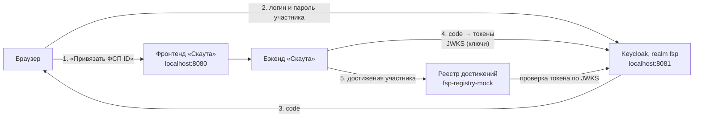
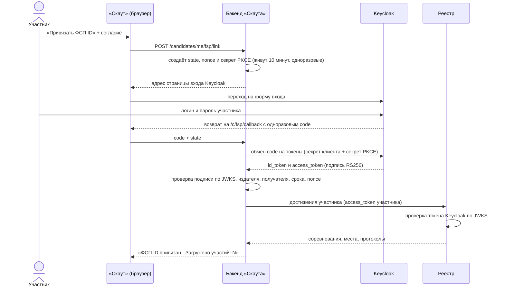

# ФСП ID на Keycloak: как устроено, как запустить, как проверить

Простое руководство по режиму, в котором вход участника ФСП обслуживает настоящий Keycloak.
Техническая справка по протоколу — в [FSP_INTEGRATION.md](FSP_INTEGRATION.md) (§10 о
Keycloak).

## 1. Коротко

- **ФСП ID** — учётная запись участника соревнований ФСП. По ТЗ она строится на Keycloak.
- **«Скаут»** не хранит пароли ФСП. Он отправляет участника на страницу входа Keycloak, а назад
  получает подписанный токен с номером участника. По номеру из **реестра достижений**
  подтягиваются соревнования, места и протоколы.
- В стенде два режима. Код один и тот же, разница только в переменных окружения:

| Режим | Кто выдаёт вход | Команда |
|---|---|---|
| Обычный, по умолчанию | лёгкий эмулятор `fsp-registry-mock` (порт 8090) | `make up` |
| Keycloak | настоящий Keycloak 26.4 (порт 8081) | `make up-keycloak` |

В обоих режимах реестр достижений — это `fsp-registry-mock`. Боевого реестра ФСП у команд нет,
поэтому эмулятор играет роль API реестра. В режиме Keycloak он принимает токены, которые
выпустил Keycloak.

## 2. Как Keycloak встроен в архитектуру

### 2.1 Кто с кем общается



Браузер ходит в Keycloak по адресу `http://localhost:8081`. Бэкенд и реестр ходят внутри
Docker-сети по адресу `http://keycloak:8080`. Это один и тот же Keycloak, просто с двух
сторон.

### 2.2 Вход по шагам (OIDC, authorization code + PKCE)



Что защищает каждый шаг:

- **state** — ответ Keycloak принимается только в той вкладке и для того пользователя, кто
  начал вход.
- **nonce** — токен выпущен именно для этого входа, его нельзя подсунуть из другого.
- **PKCE (S256)** — перехваченный `code` бесполезен без секрета, который знает только бэкенд.
  Keycloak требует PKCE обязательно: вход без него отклоняется.
- **Секрет клиента** — обменять `code` на токены может только бэкенд «Скаута».

### 2.3 Как бэкенд проверяет ключи (JWKS)

1. Бэкенд читает discovery-документ Keycloak по внутреннему адресу. Он сверяет, что `issuer` в
   нём совпадает с настроенным `http://localhost:8081/realms/fsp`: подмена провайдера не
   пройдёт.
2. Из discovery он берёт адрес JWKS — набора открытых ключей Keycloak — и кеширует ключи.
3. Каждый токен проверяется:
   - подпись RS256 ключом с тем же `kid`;
   - издатель `iss`;
   - получатель `aud` (`fsp-scout` для id_token);
   - срок действия с допуском 30 секунд;
   - `nonce`.
4. Если пришёл токен с незнакомым `kid`, значит Keycloak сменил ключи. Тогда JWKS
   перечитывается один раз автоматически, перезапуск не нужен. Это проверено: после
   пересоздания контейнера Keycloak с новым ключом бэкенд и реестр продолжили работать без
   перезапуска.

Реестр делает то же самое для access-токена. Дополнительно он требует аудиторию
`fsp-registry`: токен, выпущенный «для кого-то ещё», реестр не примет.

### 2.4 Как данные участника попадают в «Скаут»

В Keycloak поле `sub` — внутренний UUID пользователя. Номер участника в реестре (`fsp-000021`)
хранится отдельным атрибутом пользователя, и маппер кладёт его в токен.

| Где в Keycloak | Claim в токене | Куда в «Скауте» |
|---|---|---|
| атрибут `fsp_participant_id` | `fsp_participant_id` (id- и access-токен) | номер участника в привязке, ключ для реестра. Бэкенд читает его из claim, указанного в `FSP_PARTICIPANT_CLAIM` |
| атрибут `region` | `region` | регион до первой синхронизации, затем — из реестра |
| логин (`fsp000021`) | `preferred_username` | только для журнала, не хранится |
| имя, фамилия | **не передаются** | минимизация данных: платформе достаточно номера и результатов |
| — | `aud`, `scope` | права: `achievements` — свои достижения, `registry:read` — сервисное чтение |

Сами соревнования, места, разряд и протоколы приходят не из Keycloak, а из реестра. Keycloak
только подтверждает, что это действительно тот участник.

Повторная синхронизация без участия пользователя идёт по **сервисному токену**: бэкенд
получает его у Keycloak по client credentials, scope `registry:read`. Токен кешируется до
истечения и перезапрашивается, если реестр его отверг.

## 3. Как запустить

Нужен только Docker. Все команды выполняются из корня репозитория.

**Запуск в режиме Keycloak**:

```bash
make up-keycloak
```

Без `make`:

```bash
docker compose -f docker-compose.yml -f docker-compose.keycloak.yml up --build -d
```

Первый старт занимает около минуты: Keycloak импортирует realm из
[keycloak/realm-fsp.json](../keycloak/realm-fsp.json), и бэкенд ждёт его готовности.

**Проверка, что всё поднялось**:

```bash
docker compose -f docker-compose.yml -f docker-compose.keycloak.yml ps
```

У всех сервисов должно быть `healthy`.

**Автоматическая проверка за 10 секунд** — 25 проверок протокола и связки с бэкендом:

```bash
make keycloak-smoke
```

Она ничего не оставляет после себя: временная привязка в конце снимается.

**Порты**:

| Порт | Что | Доступ |
|---|---|---|
| 8080 | «Скаут» (фронтенд и API) | http://localhost:8080 |
| 8081 | Keycloak: форма входа ФСП ID и админка | http://localhost:8081, только с этого компьютера |
| 8090 | реестр достижений (эмулятор) | используется бэкендом |
| 8025 | Mailpit — письма стенда | http://localhost:8025 |
| 8000 | API бэкенда напрямую | http://localhost:8000/api/docs |

Порт Keycloak занят? Задайте другой в `.env`: `KEYCLOAK_HOST_PORT=8091`. Адрес издателя
поменяется сам.

**Вернуться на лёгкий эмулятор**:

```bash
make down-keycloak
```

Затем:

```bash
make up
```

**Начать с чистыми данными** (удаляет базу и состояние Keycloak):

```bash
docker compose -f docker-compose.yml -f docker-compose.keycloak.yml down -v --remove-orphans
```

## 4. Как проверить в браузере

### 4.1 Доступы

| Что | Адрес | Логин | Пароль |
|---|---|---|---|
| Админка Keycloak | http://localhost:8081/admin | `admin` | `admin` |
| «Скаут», кандидат | http://localhost:8080/auth/login | `candidate@example.com` | `ScoutDemo2026` |
| «Скаут», работодатель | там же | `employer@example.com` | `ScoutDemo2026` |

Все пароли — тестовые, только для локального стенда. На странице входа «Скаута» демо-аккаунты
подставляются кнопками «Специалист», «Работодатель», «Методист».

**Участники ФСП в Keycloak** (realm `fsp`, пароль у всех `FspDemo2026`):

| Логин | Кто | Номер в реестре | Что в реестре |
|---|---|---|---|
| `fsp000021` | Тимур Ким, Свердловская область | `fsp-000021` | 7 соревнований, побед и призов: 6, КМС |
| `fsp000030` | Тимур Белов, Краснодарский край | `fsp-000030` | 3 соревнования, одно призовое место, 1 разряд |
| `fsp000012` | Дмитрий Орлов, Краснодарский край | `fsp-000012` | одно участие без призового места, МС |
| `fsp000007` | Ксения Гарипова, Томская область | `fsp-000007` | ФСП ID есть, участий нет |

### 4.2 Посмотреть realm в админке

1. Откройте http://localhost:8081/admin и войдите как `admin` / `admin`. Жёлтая плашка
   «temporary admin user» — это нормально для стенда.
2. Меню ☰ слева → **Manage realms** → **fsp** (отображаемое имя «ФСП ID»).
3. **Users** — четыре участника из таблицы выше. Откройте `fsp000021`: в карточке видны
   **«Идентификатор участника в реестре ФСП»** = `fsp-000021` и **«Регион»**. Этот номер и
   уходит в токен.
4. **Clients** → **fsp-scout** — клиент «Скаута»:
   - вкладка **Settings** → **Valid redirect URIs**: адреса возврата `/c/fsp/callback` и
     `/auth/fsp/callback`;
   - там же **Capability config**: «Client authentication: On», включены только «Standard
     flow» и «Service accounts roles», **PKCE Method: S256**;
   - вкладка **Client scopes**: `achievements` и `registry:read`;
   - вкладка **Credentials**: секрет клиента. Он совпадает с `FSP_CLIENT_SECRET` бэкенда.

### 4.3 Привязать ФСП ID к аккаунту

1. Откройте http://localhost:8080/auth/login → кнопка «Специалист» → «Войти». Откроется
   кабинет `candidate@example.com`.
2. Слева **«Достижения ФСП»**.
3. Поставьте галочку согласия на получение данных из реестра ФСП → **«Привязать ФСП ID»**.
4. Откроется страница Keycloak на `localhost:8081`: «ФСП ID · Федерация спортивного
   программирования», «Вход в учётную запись». Введите `fsp000021` / `FspDemo2026` →
   **«Вход»**.
5. Вы вернётесь в «Скаут». Ожидаемый результат:
   - уведомление **«ФСП ID привязан · Загружено участий: 7»**;
   - карточка «Участник fsp-000021 · КМС · Свердловская область» с отметкой **«Подтверждено
     реестром ФСП»**;
   - ниже семь соревнований с местами, уровнем, форматом и ссылками на протоколы.

Блок «Индекс подтверждённого профиля» у `candidate@example.com` пока пустой: индекс появляется
после опроса и теста. Чтобы увидеть, как ФСП поднимает индекс, сначала пройдите экспресс-тест
(«Категория и тест»), потом привяжите ФСП ID. Появится уведомление «Индекс профиля: было →
стало».

### 4.4 Войти через ФСП ID

1. Меню пользователя справа вверху → **«Выйти»**.
2. На странице входа нажмите **«Войти через ФСП ID»**.
3. Вы сразу окажетесь в кабинете `candidate@example.com`, форму Keycloak вы даже не увидите.
   Это единый вход (SSO): Keycloak помнит, что вы уже вошли как `fsp000021`, а `fsp000021`
   привязан к этому аккаунту.

### 4.5 Сменить участника

Пока активна сессия Keycloak, он не спрашивает пароль. Чтобы войти другим участником, выйдите
из Keycloak:

1. Откройте http://localhost:8081/realms/fsp/protocol/openid-connect/logout → **«Выйти»**.
   Появится «Вы вышли из системы».
2. Снова нажмите «Войти через ФСП ID» или «Привязать ФСП ID» — теперь появится форма входа.

### 4.6 Проверить отказы

| Что сделать | Что должно быть |
|---|---|
| На форме Keycloak ввести неверный пароль | «Неправильное имя пользователя или пароль.», в «Скаут» ничего не уходит |
| Выйти из Keycloak (§4.5), затем «Войти через ФСП ID» участником `fsp000007` | «Этот ФСП ID не привязан к аккаунту «Скаута». Войдите по email и привяжите ФСП ID в разделе «Достижения ФСП» кабинета кандидата» |
| Войти другим кандидатом без привязки ФСП (например, `demo.backend.01@example.com` / `ScoutDemo2026`; если у него уже есть привязка, возьмите `demo.backend.02` и т. д.) и привязать `fsp000021` | «Этот ФСП ID уже привязан к другому аккаунту» |
| «Достижения ФСП» → «Отвязать» | Привязка и данные из реестра удаляются, индекс пересчитывается |

### 4.7 После проверки

Чтобы демо-аккаунты снова были чистыми, сбросьте стенд:

```bash
docker compose -f docker-compose.yml -f docker-compose.keycloak.yml down -v --remove-orphans
```

Затем поднимите обычный стенд:

```bash
make up
```

## 5. Что проверено

| Что | Как | Итог |
|---|---|---|
| Импорт realm | Админ-API Keycloak: клиент, scopes, мапперы, пользователи с атрибутами, секрет | совпадает с `realm-fsp.json` |
| Протокол OIDC | Скрипт проходит настоящую форму Keycloak: authorization code + PKCE, подпись по JWKS, claims, сервисный токен, реестр; отказы: без PKCE, повторный code, чужой verifier, чужой redirect_uri, неверный пароль и секрет, password grant | 23 из 23 |
| Связка с бэкендом | Через API «Скаута»: привязка, номер участника из claim, достижения и индекс, повторная синхронизация, «Войти через ФСП ID», отказы, отвязка | 13 из 13 |
| Ротация ключей | Пересоздан только Keycloak (новый `kid`), бэкенд и реестр не перезапускались | работает без перезапуска |
| Браузер | Админка, привязка `fsp000021` (7 участий), вход через ФСП ID по SSO, выход из Keycloak | как в §4 |
| Автотесты | `test_keycloak_tokens_carry_participant_in_separate_claim`, весь `tests/api/test_fsp.py`, тесты эмулятора, включая `test_registry_trusts_external_keycloak_tokens` | 466 + 6 зелёные |
| Быстрая проверка одной командой | `make keycloak-smoke` | 25 из 25 |

## 6. Если что-то не так

| Симптом | Что сделать |
|---|---|
| `make keycloak-smoke` пишет «Keycloak не отвечает» | Стенд поднят без Keycloak — выполните `make up-keycloak` |
| «Войти через ФСП ID» сразу пускает не того участника | Сессия Keycloak осталась от прошлого входа — выйдите из Keycloak (§4.5) |
| После входа на форме Keycloak «Скаут» пишет «Этот ФСП ID уже привязан к другому аккаунту» | Участник уже привязан к другому аккаунту: отвяжите его там или сбросьте стенд (§4.7) |
| Сервисы не `healthy` | `docker compose -f docker-compose.yml -f docker-compose.keycloak.yml logs keycloak backend` |
| Хочется настоящий ФСП ID вместо стенда | Поменять `FSP_OIDC_ISSUER`, `FSP_INTERNAL_URL`, `FSP_CLIENT_ID`, `FSP_CLIENT_SECRET`, `FSP_PARTICIPANT_CLAIM` и `FSP_REGISTRY_URL` ([FSP_INTEGRATION.md §9](FSP_INTEGRATION.md#9-переход-на-боевой-фсп-id)) |
