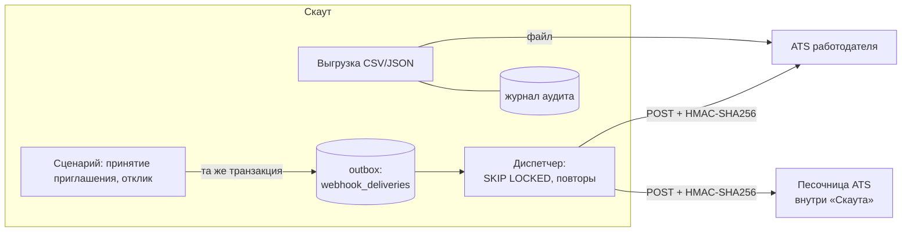

# Доверие и интеграции: защита от фиктивных работодателей и связь с ATS

Документ описывает два блока критерия №6 ТЗ: защиту от фиктивных вакансий и недобросовестных
работодателей, а также концепцию и реализацию интеграции с ATS работодателя.

## Часть 1. Защита от фиктивных вакансий и недобросовестных работодателей

### 1.1 Модель угроз

| Чем вредит фиктивный работодатель | Что мы делаем |
|---|---|
| Собирает контакты под видом приглашений | Контакты раскрываются только после принятия приглашения или отклика самого кандидата, раскрытие пишется в аудит |
| Заманивает «зарплатой мечты», а на собеседовании предлагает другое | Вилка «от–до» обязательна, не шире чем вдвое; вилка в разы выше рынка подсвечивается |
| Просит оплатить обучение или «оформление» | Отдельная причина жалобы; после трёх жалоб компания автоматически уходит на проверку |
| Заваливает ленту однотипными вакансиями и рассылками | Квоты публикаций и приглашений по уровню доверия |
| Регистрирует «компанию-однодневку» | Проверка контрольной суммы ИНН и уровень доверия «новая компания» по умолчанию |

### 1.2 Механизмы

**Квоты по уровню доверия.** У компании три уровня доверия: «новая», «проверенная»,
«подтверждённая». Уровень меняет модератор.

| Уровень | Приглашений в день | Опубликованных вакансий одновременно |
|---|---|---|
| Новая компания | 20 | 5 |
| Проверенная | 50 | 20 |
| Подтверждённая | 100 | 100 |

**Вилка зарплаты.** В приглашении и вакансии вилка «от–до» обязательна. «От» не больше «до», и
«до» не больше двух «от». Ограничение проверяется на уровне схемы API и CHECK-ограничением в
базе. Налоговая база (до вычета НДФЛ или на руки) указывается явно.

**Сверка вилки с рынком.** Вилка вакансии сравнивается с медианой открытых ожиданий кандидатов
той же категории. Ожидания приводятся к одной налоговой базе. Медиана считается, только если
открытых ожиданий не меньше трёх, как в рыночном срезе подборки.

| Условие | Статус | Кто видит |
|---|---|---|
| «до» < 0,6 × медианы | `below_market` — откликов будет мало | Работодатель на странице вакансии |
| «от» > 2 × медианы | `suspicious` — так часто выглядят фиктивные вакансии | Работодатель и модератор |
| Иначе | `ok` | — |
| Меньше трёх ожиданий | `unknown` | — |

**Проверка ИНН.** ИНН организации (10 цифр) и ИП (12 цифр) проверяется по контрольным цифрам
алгоритма ФНС. Выдуманный номер не сохранится. Сверка с ЕГРЮЛ — следующий шаг (§1.5).

**Жалобы.** Кандидат жалуется на приглашение, вакансию или компанию. Причины: фиктивное
предложение, несовпадение условий, просьба заплатить, рассылка, некорректное общение, другое.

- Один кандидат может пожаловаться на один объект один раз. Это уникальный индекс в базе: иначе
  один человек мог бы в одиночку заблокировать компанию.
- Пожаловаться можно только на то, что кандидат видел: на своё приглашение или опубликованную
  вакансию.
- Частота ограничена: 20 жалоб в час с одного адреса.
- Работодатель не узнаёт, кто пожаловался.

**Автоматическое ограничение.** Жалобы трёх разных кандидатов за 30 дней ставят компанию на
проверку. Пока проверка идёт:

- нельзя отправлять приглашения, публиковать вакансии и создавать микрозадачи. Сервер отвечает
  `403 company_restricted`, а кабинет показывает баннер заранее;
- уже отправленные приглашения и отклики остаются в силе;
- кандидат видит в карточке компании предупреждение «на проверке модератора»;
- рекрутеры компании получают уведомление.

**Модерация.** Методист разбирает очередь жалоб на странице «Модерация» (`/m/moderation`).

- Жалобу можно подтвердить или отклонить. Подтверждённая попадает в репутацию компании.
- Компанию можно ограничить вручную с указанием причины или снять ограничение.
- Можно сменить уровень доверия.
- Компании с сигналами стоят выше: ограниченные, с открытыми жалобами, с подозрительными вилками.
- Все решения пишутся в журнал аудита.

**Репутация.** Это факты, а не непрозрачный балл. Кандидат видит их в карточке компании до
ответа на приглашение:

- доля откликов, на которые компания ответила;
- доля принятых приглашений среди отвеченных;
- число подтверждённых жалоб;
- дата появления компании на платформе.

Проценты показываются, только когда событий не меньше трёх: иначе одна случайность выглядела бы
как характеристика.

### 1.3 Где в коде

| Слой | Модули |
|---|---|
| Модели | `models/trust.py` — `Complaint`; поля `restricted_at`, `restriction_reason` у `Company` |
| CRUD | `crud/trust.py` — жалобы, счётчики репутации |
| Сервисы | `services/trust/` — `complaint_service`, `moderation_service`, `guard`, `reputation`, `market`, `salary_check`; `core/inn.py` |
| API | `POST /complaints`; `/moderation/complaints`, `/moderation/companies/{id}/restrict\|lift\|trust` |
| Интерфейс | «Пожаловаться» и репутация в карточке компании; предупреждение о вилке у вакансии; баннер ограничения; страница «Модерация» |
| Тесты | `tests/unit/test_trust.py`, `tests/api/test_trust.py` |

### 1.4 Как проверить

1. Под тремя кандидатами пожалуйтесь на одну вакансию «Кедр Технологии». Подойдут
   `candidate@example.com` и любые `demo.*@example.com` с паролем `ScoutDemo2026`.
2. Под `employer@example.com` появится баннер «Компания на проверке модератора», а публикация
   вакансии вернёт отказ.
3. Под `methodist@example.com` откройте «Модерация». Подтвердите жалобу и снимите ограничение.
4. В карточке компании у кандидата появится «подтверждённых жалоб: 1».

### 1.5 Следующие шаги

- Сверка ИНН с ЕГРЮЛ (API ФНС) и подтверждение корпоративного домена email рекрутера. По этим
  сигналам уровень «проверенная» будет присваиваться автоматически.
- Ограничения по скорости: однотипные приглашения одним и тем же кандидатам, всплески вакансий.
- Апелляция работодателя на ограничение прямо из кабинета.

## Часть 2. Интеграция с ATS работодателя

### 2.1 Концепция

«Скаут» не заменяет ATS компании (Хантфлоу, Поток, E-Staff, собственные системы), а
встраивается в неё. Платформа сильна в поиске и верификации кандидата. Воронку дальше ведёт
ATS. Поэтому интеграция однонаправленная и событийная. Как только кандидат открыл компании
контакты, ATS получает карточку и может завести кандидата без ручного переноса.



Два канала:

- **Вебхуки** — для ATS с API: события приходят сразу, подписанные секретом компании.
- **Выгрузка CSV/JSON** — для ATS без вебхуков и для разовой миграции. Файл импортируется
  вручную или по расписанию.

В ATS попадает только то, что кандидат сам открыл компании: события с контактами отправляются
лишь после принятия приглашения или отклика, а каналы связи — только разрешённые в приватности.

### 2.2 События

| Тип | Когда | Контакты |
|---|---|---|
| `invitation.accepted` | Кандидат принял приглашение | Да |
| `invitation.declined` | Кандидат отклонил приглашение (с причиной) | Нет, только псевдоним |
| `application.created` | Кандидат откликнулся на вакансию | Да, отклик открывает контакты |
| `application.withdrawn` | Кандидат отозвал отклик | Нет, только псевдоним |
| `ping` | «Проверить связь» в кабинете | — |

Тело события (комментарии добавлены для пояснения):

```jsonc
{
  "id": "6c1f…",                      // event_id: ключ идемпотентности
  "type": "invitation.accepted",
  "created_at": "2026-10-08T08:32:11+00:00",
  "company_id": "1b7e…",
  "data": {
    "invitation": {"id": "…", "title": "Python-разработчик", "salary_from": 250000,
                   "salary_to": 320000, "salary_gross": true, "work_format": "remote"},
    "candidate": {"candidate_id": "…", "full_name": "Иван Петров", "email": null,
                  "telegram": "ivan_dev", "category": "Backend-разработка · Middle",
                  "grade_confirmed": true, "verified_score": 71.5,
                  "skills": ["Python", "FastAPI"], "source": "invitation_accepted",
                  "profile_url": "http://localhost:8080/e/candidates/…"}
  }
}
```

### 2.3 Надёжность доставки: outbox и повторы

- **Outbox.** Запись о доставке создаётся в той же транзакции, что и событие. Если принятие
  приглашения откатилось, события не было и отправлять нечего. Если транзакция зафиксирована,
  событие не потеряется даже при падении процесса сразу после неё.
- **Диспетчер** — фоновая задача приложения. Каждые 2 секунды он берёт созревшие доставки через
  `SELECT … FOR UPDATE SKIP LOCKED` и «арендует» их на две минуты. Запрос получателю уходит вне
  транзакции, итог записывается второй короткой транзакцией. Несколько процессов разбирают
  очередь параллельно и не мешают друг другу. Упавший посреди отправки процесс отпустит аренду,
  и доставка повторится.
- **Повторы.** Ответ 2xx — «доставлено». Иначе повторы через 1, 5, 30 минут, 2 и 6 часов. После
  шестой попытки доставка помечается «не доставлено», и рекрутеры получают уведомление. Повторить
  вручную можно кнопкой в журнале: новая запись получит тот же `event_id`.
- **Идемпотентность.** Гарантия доставки — «хотя бы один раз». Получатель отбрасывает дубли по
  `X-Scout-Event-Id`.

### 2.4 Безопасность

- **Подпись.** `X-Scout-Signature: sha256=HMAC_SHA256(secret, "<timestamp>.<тело>")`, метка
  времени передаётся в `X-Scout-Timestamp`. Подписи старше пяти минут получатель отвергает, поэтому
  перехваченный запрос нельзя повторить позже.
- **Секрет.** Это 256 бит случайности с префиксом `whsec_`. Полностью он показывается только при
  подключении и смене, дальше в кабинете видна подсказка `whsec_ab12…yz89`. После смены старый
  секрет сразу перестаёт действовать.
- **SSRF.** Адрес получателя не может вести во внутреннюю сеть платформы: localhost, частные и
  служебные диапазоны, облачные метаданные `169.254.169.254`, имена `*.internal` и `*.local`. Имя
  разрешается в IP при сохранении и повторно перед каждой отправкой, чтобы не сработала подмена
  DNS-записи. Перенаправления не выполняются, а в production разрешён только HTTPS. Для отладки
  своего приёмника на локальном стенде проверку отключает `WEBHOOK_ALLOW_PRIVATE_URLS=true`.
- **Аудит.** Подключение и удаление получателя, смена секрета и каждая выгрузка пишутся в журнал
  аудита: через интеграции уходят персональные данные.
- **Лимиты.** До 5 получателей на компанию. Выгрузка — до 30 раз в час.

Проверка подписи на стороне ATS (Python):

```python
import hashlib, hmac, time

def verify(secret: str, headers: dict, body: bytes) -> bool:
    timestamp = headers["X-Scout-Timestamp"]
    if abs(time.time() - int(timestamp)) > 300:
        return False
    expected = "sha256=" + hmac.new(
        secret.encode(), timestamp.encode() + b"." + body, hashlib.sha256
    ).hexdigest()
    return hmac.compare_digest(expected, headers["X-Scout-Signature"])
```

### 2.5 Песочница ATS

Чтобы показать интеграцию без внешней системы, в «Скауте» есть встроенный получатель
`POST /api/v1/integrations/sandbox/receive`. Он ведёт себя как настоящая ATS. По заголовку
`X-Scout-Delivery` он находит секрет получателя и проверяет подпись так же, как код выше. Затем
отвечает квитанцией, например «Песочница ATS: Карточка кандидата «Иван Петров» заведена».
Ответ виден в журнале доставок. Неверная подпись получает `401`.

### 2.6 Выгрузка

`GET /api/v1/employer/integrations/export?format=csv|json` выгружает всех кандидатов, открывших
компании контакты: приглашение принято или есть отклик.

- Поля те же, что в событиях: контакты по приватности, категория, подтверждённость грейда,
  индекс, навыки, источник и дата раскрытия, ссылка на карточку.
- CSV в UTF-8 с BOM открывается в Excel без настройки кодировки.

### 2.7 Где в коде

| Слой | Модули |
|---|---|
| Модели | `models/integration.py` — `WebhookEndpoint`, `WebhookDelivery` (outbox), миграция 0009 |
| CRUD | `crud/integration.py` — подписчики события, `lock_due` с `SKIP LOCKED`, журнал |
| Сервисы | `services/integrations/` — `publisher` (outbox), `dispatcher` (отправка и повторы), `signing`, `url_guard` (SSRF), `snapshot` (кандидат для ATS), `sandbox`, `export`, `integration_service` |
| Точки публикации | `InvitationService.accept/decline`, `VacancyBoardService.apply/withdraw` |
| API | `/employer/integrations/{events, webhooks, sandbox, deliveries, export}`, `/integrations/sandbox/receive` |
| Интерфейс | Кабинет работодателя → «Интеграции» |
| Тесты | `tests/unit/test_integrations.py`, `tests/api/test_integrations.py` |

### 2.8 Как проверить

1. Под `employer@example.com` откройте «Интеграции» → «Подключить песочницу». Сохраните секрет →
   «Проверить связь». Через пару секунд в журнале появится «Доставлено» с ответом песочницы
   «Связь установлена, подпись верна».
2. Под кандидатом примите приглашение «Кедр Технологии» или откликнитесь на вакансию. В журнале
   появится событие с карточкой кандидата. «Тело события» показывает JSON целиком.
3. «Выгрузка кандидатов» → «CSV для Excel».
4. Повторы и уведомление о сбое проверяет тест `test_failed_delivery_retries_with_backoff_then_notifies`:
   ATS отвечает 503, диспетчер делает шесть попыток с паузами 1 мин → 6 ч. Затем доставка
   помечается «не доставлено», рекрутер получает уведомление, ручной повтор сохраняет `event_id`.
   На живом стенде с интернетом то же видно, если подключить адрес, который отвечает ошибкой.
